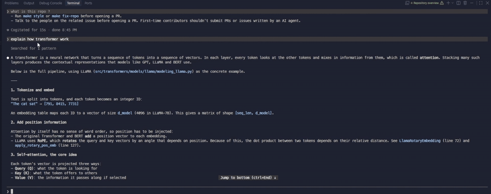

<p align="center">
  <strong>Explain with pictures, not walls of text.</strong><br>
  Dyslexia-friendly AI explanations. No diagnosis needed.
</p>
<p align="center">
  <a href="LICENSE"></a>
</p>

<p align="center">
  
</p>

## Install

In Claude Code:

```text
/plugin marketplace add i-have-dyslexia/i-have-dyslexia
/plugin install i-have-dyslexia@i-have-dyslexia
```

Or copy/paste into any AI coding tool:

```text
Install the i-have-dyslexia skill from https://github.com/i-have-dyslexia/i-have-dyslexia, refer to the repo's AGENTS.md for instructions.
```

Or see [INSTALL.md](INSTALL.md).

## What it does

Every time the AI explains something, it **shows a picture first**. Then a few short, plain sentences.

```
  Question ──▶ Visual ──▶ Short text ──▶ "In short" line
```

The picture is picked to fit the idea:

| The idea is... | You get a... |
|---|---|
| Steps or a process | Flow |
| A comparison | Table |
| Parts of a whole | Tree |
| Something over time | Timeline |
| Amounts | Bar chart |
| A decision | Yes/no branch |

## How to use

| Type | What happens |
|---|---|
| `/i-have-dyslexia` | Redraws the **last answer** as visuals. One time. |
| `/i-have-dyslexia <topic>` | Explains **that topic** visually. One time. |
| `/i-have-dyslexia on` | Turns it on for **every answer** in the session. |

Example: `/i-have-dyslexia how compound interest works`

## Before / after

<table>
<tr>
<td width="50%">

### Before

> A transformer is a neural network that turns a sequence of tokens into a sequence of vectors. In each layer, every token looks at the other tokens and mixes in information from them, which is called attention. Each token's vector is projected three ways: a query (what the token is looking for), a key (what it offers to others) and a value (the information it passes along if selected). In "The cat sat because it was tired", the query for "it" scores highly against the key for "cat", so the output vector for "it" absorbs information about the cat. Stacking many such layers produces the contextual representations that models like GPT, LLaMA and BERT use.

</td>
<td width="50%">

### After

```
 Text ──▶ Tokens ──▶ Vectors
                       │
                       ▼
               ┌── Layer × N ──┐
               │   Attention   │
               │   MLP         │
               └───────────────┘
                       │
                       ▼
                  Next token
```

1. **Attention:** each token looks at the other tokens.
2. Example: "The cat sat because **it** was tired."
   **it** ──▶ looks at **cat** ──▶ learns what "it" means.
3. **Stack** many layers and you get GPT or LLaMA.

**In short:** tokens look at each other, layer by layer, then guess the next word.

</td>
</tr>
</table>

## Turn it off

A one-time redraw or topic has nothing to turn off.

For `on` mode, say **"stop dyslexia mode"**.

## Why pictures?

Dyslexia makes decoding words slow and tiring. Shapes and layout are read much faster. A picture cuts the amount of text the reader has to get through.

## License

[MIT](LICENSE)
